# traza. — visualizador de algoritmos

Visualizador web interactivo de algoritmos y estructuras de datos, **en español**, pensado para
estudiantes de programación y para quienes preparan entrevistas técnicas.

**▶ Demo:** https://stikyu.github.io/visualizador-algoritmos/

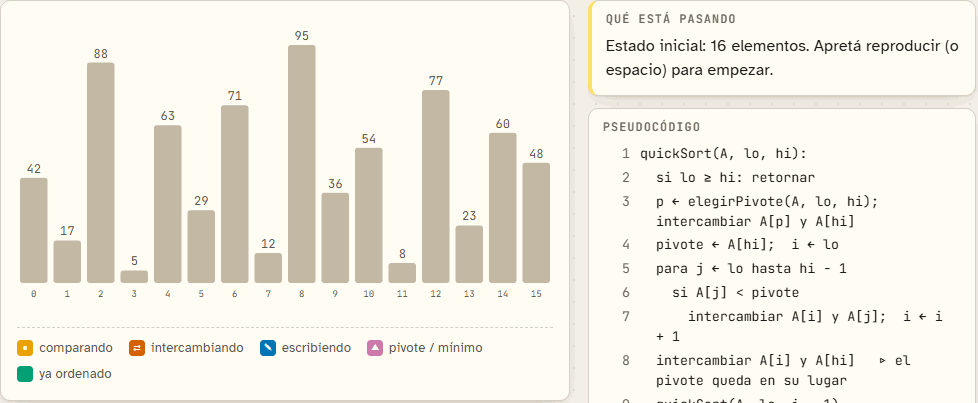

Cada algoritmo deja una **traza**: la lista completa de lo que hizo (comparar, intercambiar,
visitar, relajar…). La app la reproduce como un video: play, pausa, paso adelante y atrás,
velocidad, saltar a cualquier punto. En cada paso se ve la línea de pseudocódigo activa, una
explicación en castellano de lo que está pasando, el valor de las variables y contadores de
comparaciones, intercambios y accesos.

## Capturas

| | |
|---|---|
| 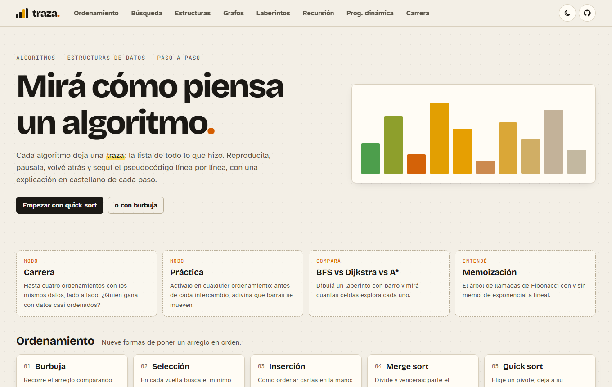 | 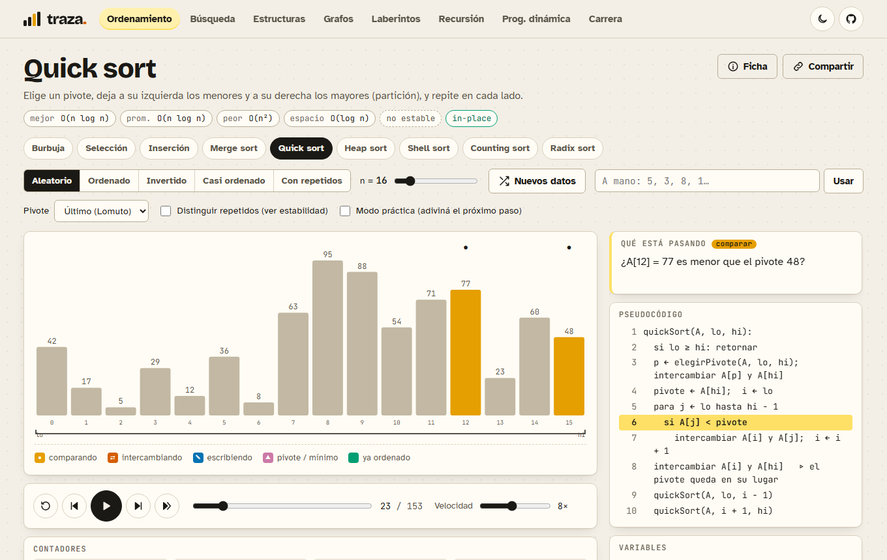 |
| **Inicio** con el catálogo completo | **Quick sort** con pivote configurable |
| 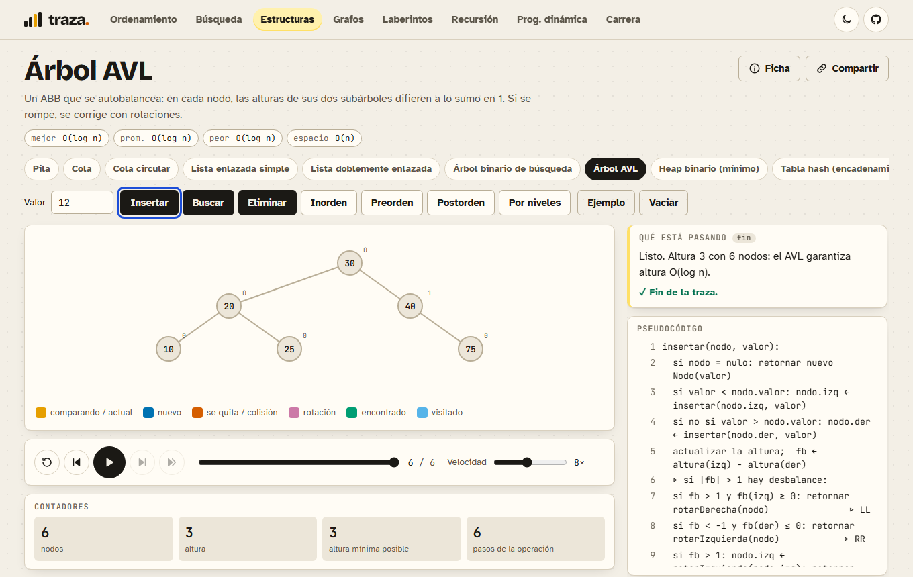 | 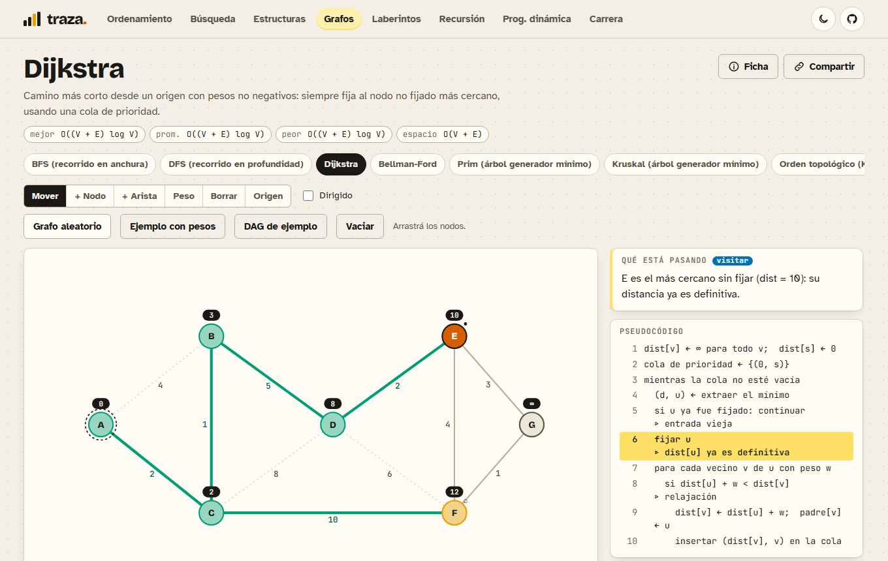 |
| **Árbol AVL** con factores de balance | **Dijkstra** sobre un grafo editable |
| 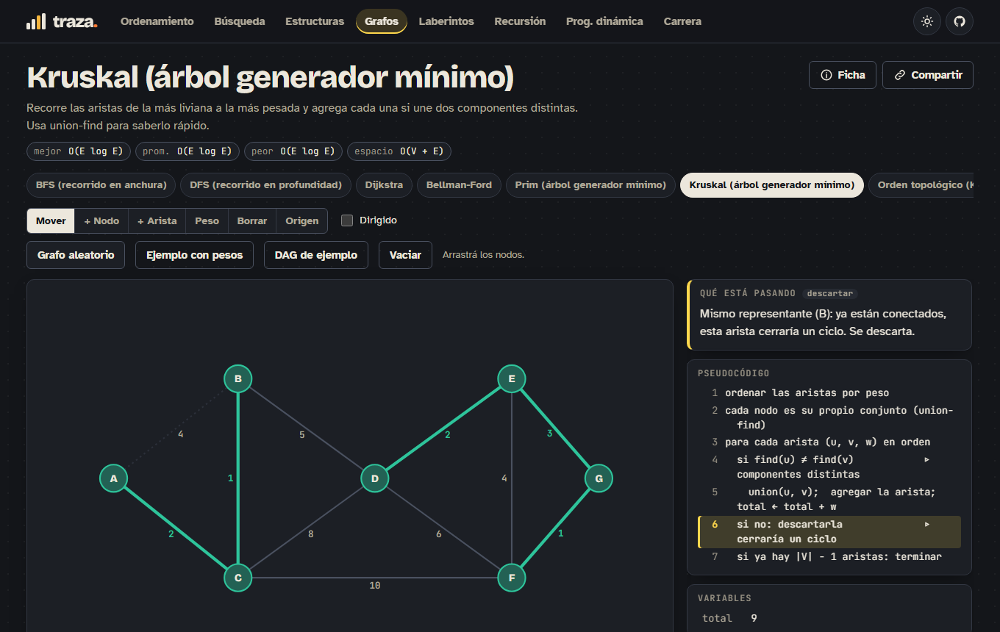 | 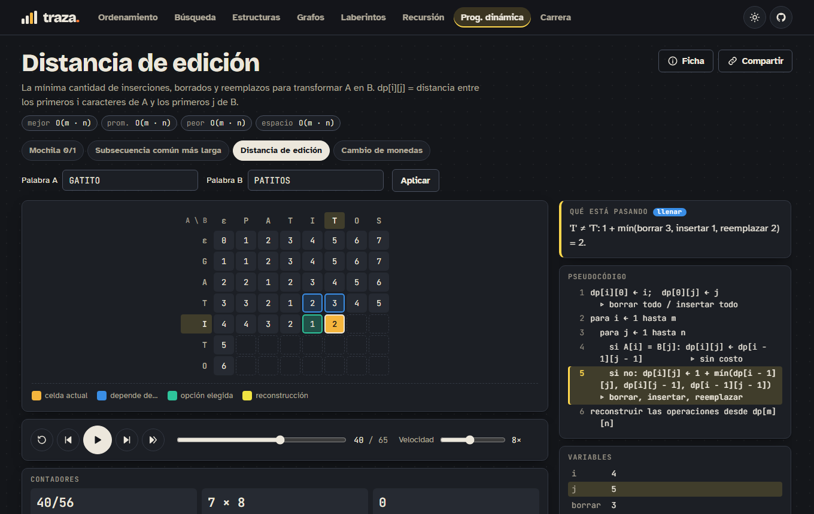 |
| **Kruskal** mostrando el union-find (modo oscuro) | **Distancia de edición**: la tabla se llena celda por celda |
| 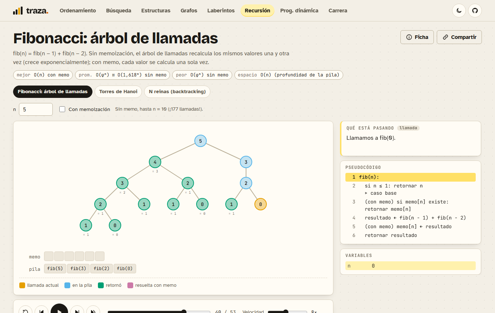 | 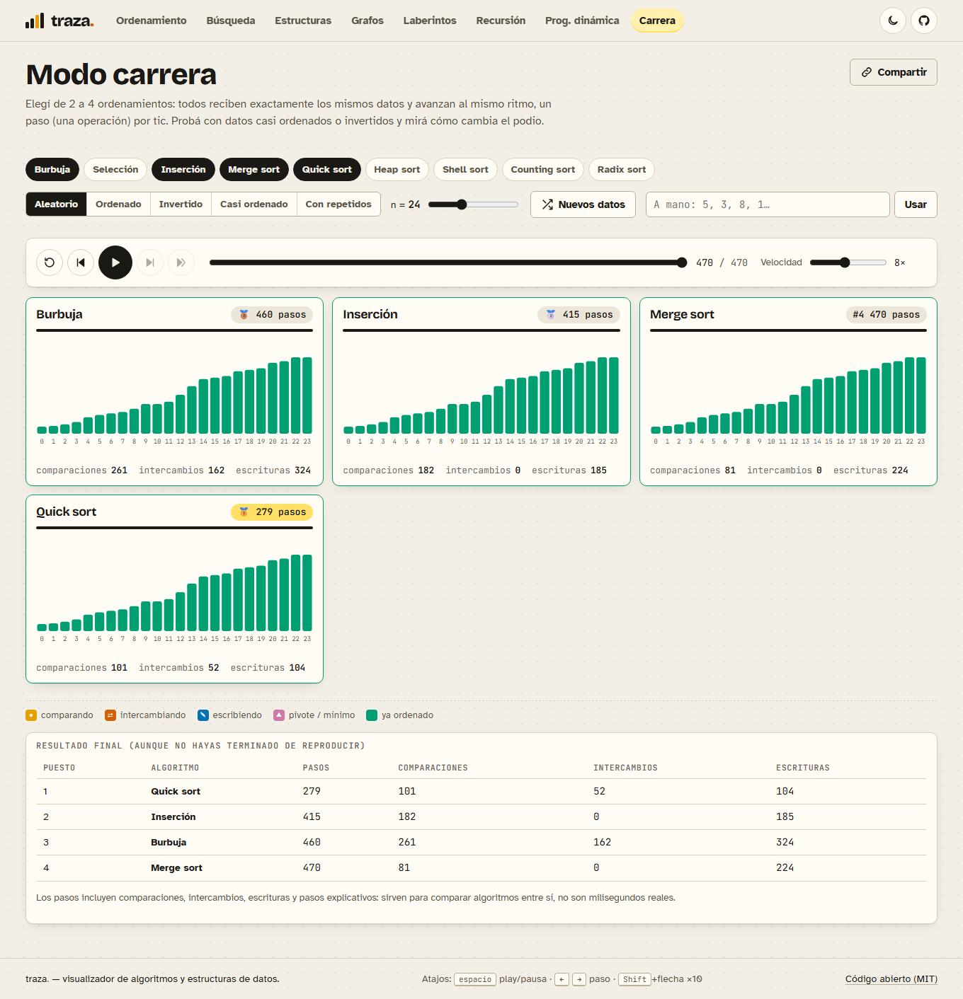 |
| **Árbol de llamadas** de Fibonacci | **Modo carrera** entre ordenamientos |

<details>
<summary>Más: laberintos y vista móvil</summary>

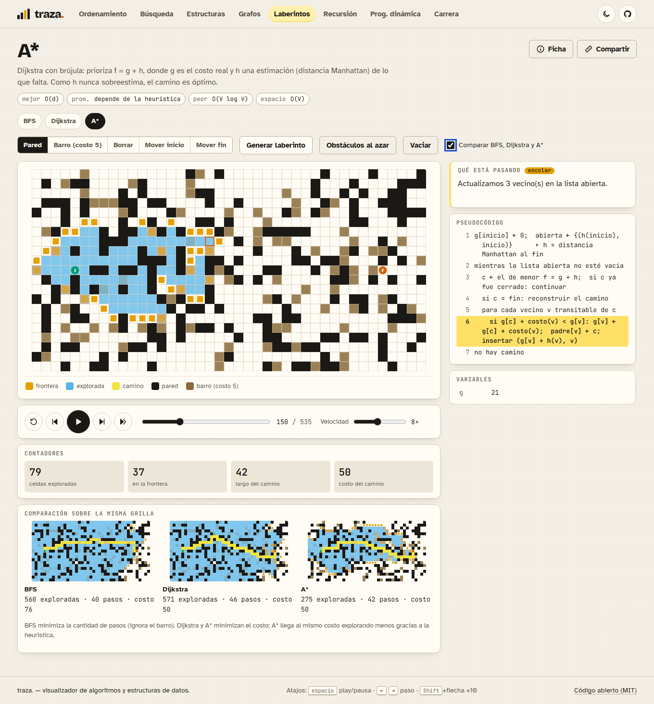

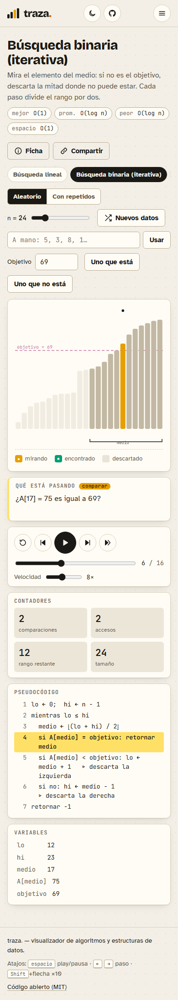

</details>

## Qué incluye

Funcionalidades comunes a todos los algoritmos:

- Panel de **pseudocódigo** con la línea actual resaltada.
- Panel **"Qué está pasando"** con la explicación del paso.
- Panel de **variables** (i, j, pivote, distancias, cola, pila…), con los cambios resaltados.
- **Contadores** derivados de la traza (comparaciones, intercambios, escrituras, accesos, relajaciones…).
- **Reproductor**: play/pausa, paso adelante y atrás, velocidad (0,5 a 300 pasos/s), reiniciar,
  barra de progreso navegable. Atajos: <kbd>espacio</kbd>, <kbd>←</kbd> <kbd>→</kbd>
  (<kbd>Shift</kbd> = ×10), <kbd>Inicio</kbd> / <kbd>Fin</kbd>.
- **Entrada configurable**: aleatoria, ordenada, invertida, casi ordenada, con repetidos o a mano.
- **Compartir por link**: el algoritmo y los datos (arreglo, grafo, laberinto, palabras…) viajan en la URL.
- **Ficha por algoritmo**: complejidad en mejor/promedio/peor caso, espacio, estabilidad, cuándo
  conviene usarlo, cuándo no, y comparación con los de su familia.
- Modo claro/oscuro, diseño responsive, accesible por teclado, colores aptos para daltonismo
  (paleta Okabe-Ito + marcas de forma ● ⇄ ✎ ▲ ★), respeta "reducir movimiento".

### Algoritmos y estructuras, por etapa

- [x] **Etapa 1 – Motor y ordenamiento**
  - [x] Reproductor completo y vista de barras
  - [x] Burbuja · Selección · Inserción · Merge sort · Quick sort (pivote: último, primero, medio, aleatorio, mediana de tres) · Heap sort · Shell sort (brechas de Shell o Knuth) · Counting sort · Radix sort
  - [x] Colores consistentes para comparar, intercambiar, escribir, pivote y "ya ordenado"; opción para ver la estabilidad con valores repetidos
- [x] **Etapa 2 – Búsqueda**
  - [x] Lineal · Binaria iterativa · Binaria recursiva (con pila de llamadas) · Interpolación, mostrando cómo se achica el rango `lo..hi`
- [x] **Etapa 3 – Estructuras de datos**
  - [x] Pila · Cola · Cola circular
  - [x] Lista enlazada simple (con inversión) y doble (con recorrido al revés)
  - [x] Árbol binario de búsqueda: insertar, buscar, eliminar (los tres casos), recorridos inorden / preorden / postorden / por niveles
  - [x] Árbol AVL con rotaciones animadas (LL, RR, LR, RL) al insertar y al eliminar
  - [x] Heap binario (insertar, extraer mínimo) en vista de árbol y de arreglo
  - [x] Tabla hash con encadenamiento y con direccionamiento abierto (sondeo lineal y lápidas)
- [x] **Etapa 4 – Grafos**
  - [x] Editor: agregar y mover nodos, aristas con peso, dirigido / no dirigido, grafos aleatorios, borrar, elegir origen
  - [x] BFS · DFS · Dijkstra · Bellman-Ford (con detección de ciclos negativos) · Prim · Kruskal (mostrando el union-find) · Orden topológico (Kahn) · Detección de ciclos
  - [x] Grilla tipo laberinto: paredes y barro dibujables, generador de laberintos, BFS / Dijkstra / A* y comparación de celdas exploradas
- [x] **Etapa 5 – Recursión y programación dinámica**
  - [x] Árbol de llamadas de Fibonacci con y sin memoización · Torres de Hanoi · N reinas con backtracking
  - [x] Tablas que se llenan celda por celda: mochila 0/1 · subsecuencia común más larga · distancia de edición · cambio de monedas (con reconstrucción de la solución)
- [x] **Etapa 6 – Extras y pulido**
  - [x] Modo carrera: 2 a 4 ordenamientos lado a lado con los mismos datos
  - [x] Modo práctica: predecir qué se intercambia (o dónde se escribe) antes de cada paso
  - [x] Ficha por algoritmo con complejidad, cuándo usarlo y comparación
  - [x] Estado compartible por link, modo claro/oscuro, responsive y accesibilidad básica (0 violaciones WCAG 2 A/AA según axe-core en las páginas principales)

## Stack

- **React 19 + TypeScript** (modo estricto) + **Vite**
- Renderizado con **SVG**; **Canvas 2D** sólo para la grilla (cientos de celdas cambiando por paso)
- Animaciones con **Motion** (ex Framer Motion) y transiciones CSS
- **Vitest** para tests, **ESLint** + **Prettier**
- Sin backend: todo corre en el navegador. Deploy en **GitHub Pages**

## Cómo correrlo

Requiere Node 20.19+ (probado con Node 26).

```bash
npm install
npm run dev          # http://localhost:5173
npm test             # tests con Vitest
npm run lint         # ESLint + Prettier
npm run build        # build de producción en dist/
npm run screenshots  # regenera las capturas de docs/img (requiere build previo y Playwright)
```

## Arquitectura (resumen)

```
entrada ──▶ generador del algoritmo ──▶ traza (lista de pasos) ──▶ Timeline ──▶ reproductor ──▶ renderer
            function* quickSort(…)       compare, swap, mark…      reducer +      posición p     barras, árbol,
            (sin React)                  + línea, texto, variables  checkpoints    play/pausa…    grafo, tabla…
```

```
src/
  algorithms/   cada algoritmo es una función generadora que emite pasos tipados. CERO React.
  structures/   estructuras de datos como valores inmutables + operaciones generadoras
  player/       Timeline (estado en cualquier posición) y el hook del reproductor
  renderers/    vistas: barras, árbol, lista, grafo, grilla (canvas), tabla de PD…
  explain/      paneles de pseudocódigo, explicación y variables
  ui/           layout, páginas, router por hash, tema, entradas
tests/          tests de Vitest (algoritmos, estructuras, consistencia de trazas)
docs/           arquitectura y capturas
```

Las ideas clave:

1. **Los algoritmos son generadores** que emiten pasos (`yield step.compare([i, j], …)`). No saben
   nada de la interfaz.
2. **Primero se genera la traza completa** y después el reproductor la recorre: por eso se puede ir
   hacia atrás, saltar a cualquier paso, correr carreras y hacer el modo práctica.
3. **Un reductor puro** `(estado, paso) → estado` interpreta los pasos. La `Timeline` guarda un
   checkpoint cada 32 pasos para obtener el estado de cualquier posición rápido y sin guardar todo.
4. **Los renderers sólo dibujan estados**. Los contadores se derivan de los pasos, así que nunca se
   desincronizan de la animación.

La explicación completa, con el porqué de cada decisión, está en
**[docs/arquitectura.md](docs/arquitectura.md)**.

## Cómo agregar un algoritmo nuevo

Ejemplo: agregar **cocktail shaker sort** (burbuja en ambas direcciones).

**1.** Crear `src/algorithms/sorting/cocktail.ts` con los metadatos, el pseudocódigo y el generador:

```ts
import { step } from '../array/steps';
import { range, type SortAlgorithm } from './types';

export const cocktailSort: SortAlgorithm = {
  meta: {
    id: 'cocktail',
    name: 'Cocktail shaker',
    category: 'ordenamiento',
    summary: 'Burbuja de ida y vuelta: alterna pasadas hacia la derecha y hacia la izquierda.',
    pseudocode: [
      'repetir mientras haya intercambios',
      '  pasada de izquierda a derecha intercambiando vecinos desordenados',
      '  pasada de derecha a izquierda intercambiando vecinos desordenados',
    ],
    complexity: { best: 'O(n)', average: 'O(n²)', worst: 'O(n²)', space: 'O(1)' },
    stable: true,
    inPlace: true,
    whenToUse: ['Para enseñar: mejora a burbuja cuando hay "tortugas" (chicos al final).'],
    avoidWhen: ['Arreglos grandes.'],
  },
  *run(input) {
    const a = input.slice();
    let swapped = true;
    while (swapped) {
      swapped = false;
      for (let j = 0; j < a.length - 1; j++) {
        yield step.compare([j, j + 1], { line: 2, text: `¿${a[j].value} > ${a[j + 1].value}?`, vars: { j } });
        if (a[j].value > a[j + 1].value) {
          [a[j], a[j + 1]] = [a[j + 1], a[j]];
          swapped = true;
          yield step.swap(j, j + 1, { line: 2, text: 'Se intercambian.', vars: { j } });
        }
      }
      // … pasada de vuelta (línea 3) …
    }
    yield step.mark(range(a.length), { line: 0, text: 'Arreglo ordenado.', vars: {} });
    return a; // el arreglo ordenado: los tests lo comparan con Array.prototype.sort
  },
};
```

**2.** Sumarlo a la lista en `src/algorithms/sorting/index.ts`:

```ts
export const SORTING_ALGORITHMS = [bubbleSort, /* … */, cocktailSort];
```

**3.** Listo. Sin tocar la interfaz, el algoritmo aparece en el inicio, en el selector, en la ficha,
en el modo carrera y en el modo práctica. Y como `tests/sorting.test.ts` recorre
`SORTING_ALGORITHMS`, el algoritmo nuevo queda testeado automáticamente: cientos de arreglos
contra `Array.prototype.sort`, estabilidad (porque declaró `stable: true`) y consistencia de la traza.

Para otras categorías el patrón es el mismo: búsqueda (`src/algorithms/search`), grafos
(`src/algorithms/graph/index.ts`), grilla (`src/algorithms/grid/search.ts`), PD
(`src/algorithms/dp/problems.ts`) y estructuras (`src/structures/index.ts`). Si el algoritmo
necesita una vista nueva, se agrega un renderer en `src/renderers/` que reciba el estado.

## Tests

`npm test` corre 106 tests, entre ellos:

- Cada ordenamiento contra `Array.prototype.sort` con más de 300 arreglos aleatorios (vacíos, de un
  elemento, con repetidos y negativos), con todas sus variantes de opciones; estabilidad en los que
  dicen ser estables.
- **Consistencia de la traza**: reproducir los pasos desde el estado inicial da exactamente el
  resultado del algoritmo; la Timeline con checkpoints coincide con aplicar los pasos uno por uno.
- Estructuras: propiedad de ABB (con rangos), balance y alturas del AVL, propiedad de heap, tablas
  hash y listas comparadas contra modelos simples (`Set`, arreglos).
- Grafos: Dijkstra y Bellman-Ford contra resultados conocidos y contra Floyd-Warshall; Prim y Kruskal
  con el mismo peso total; orden topológico válido; detección de ciclos contra una verificación
  independiente; A* con el mismo costo que Dijkstra explorando a lo sumo lo mismo.
- Recursión y PD: fórmulas cerradas (llamadas de Fibonacci, 2ⁿ − 1 movimientos de Hanoi, cantidad de
  soluciones de N reinas) y comparación contra fuerza bruta (mochila, LCS, Levenshtein, monedas).

## Limitaciones conocidas

- La traza se genera completa antes de reproducir, así que el tamaño de entrada está acotado
  (arreglos de hasta 120 elementos, grafos de hasta 40 nodos, Fibonacci sin memo hasta n = 10).
- Los "pasos" del modo carrera son operaciones elementales, no tiempo real de ejecución.
- La interfaz está sólo en español.

## Contribuir

¡Las contribuciones son bienvenidas! Mirá [CONTRIBUTING.md](CONTRIBUTING.md).

## Licencia

[MIT](LICENSE)
